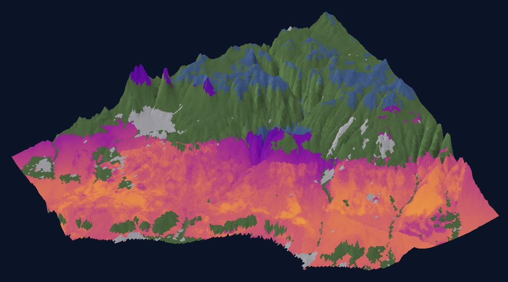

<div align="center">



<h1>Marte en Moquegua</h1>

<h3><i>We found Mars without leaving Moquegua.</i></h3>

<p>
From satellite data to choosing analog test sites. The tool <b>finds</b> hyper-arid places in southern Peru that resemble Mars,<br>
<b>compares</b> them with known analogs and <b>plans</b> a rover test, an analog EVA or a sampling route, with a downloadable report.
</p>

<p>


</p>

<p><b>Team: 404 Sleep Not Found</b> · Local event: Moquegua, Peru</p>

</div>

---

## The challenge

> **Identify Earth Locations that Analog the Permanent Moon Base Locations and Mars.**

NASA and its partners test rovers, train crews and calibrate instruments in places on Earth that behave like Mars. Known analogs are few and far apart, and many were chosen from field experience. **We focused on Mars** and built a transparent, reproducible screening tool for southern Peru.

## Two questions, two indices

Following the *functional analogue* concept (Foucher et al., 2021), the tool keeps two questions separate:

| Index | Question | Inputs | Depends on the user? |
|---|---|---|---|
| **Environmental similarity to Mars** (0–100) | Do climate and soil resemble Mars? | Ground thermal swing, UNEP aridity, EMIT minerals | No |
| **Suitability for your mission** (% of area) | Can I operate there? | Slope, road access, protected areas, dark sky, data coverage | Yes: **Test**, **Train** or **Study** mode |

Slope is **not** treated as Mars-likeness. Flat terrain is more *operable*, not more *Martian*.

## Results (screening, not field-validated)

| Site | UNEP class (AI) | Environmental similarity | Sensitivity range* | Data |
|---|---|:-:|:-:|:-:|
| **Pampas de El Algarrobal** (Ilo) | Hyper-arid (0.030) | **71** | 43–86 | 3/3 |
| **Pampas costeras de Islay** | Hyper-arid (0.046) | **70** | 41–84 | 3/3 |
| **Pampas de Ilo–Jorge Basadre** | Hyper-arid (0.018) | **66** | 37–89 | 3/3 |
| *Yungay, Atacama (scale anchor)* | *Hyper-arid (0.0014)* | *67* | *48–89* | 3/3 |
| Pampas de La Joya (known analog) | Arid (0.057) | 58 | 35–68 | 3/3 |
| Pampa de Clemesí (known analog) | Arid (0.052) | 57 | 35–68 | 3/3 |
| *Mars Desert Research Station, Utah* | *Arid/semi-arid boundary (0.199)* | *26* | *9–41* | 3/3 |

\*5–95% range over 2,400 runs that vary the thermal reference (60/80/100 °C), the aridity scaling (linear or log), the aridity anchor and the weights (seed 1).

**What we can say:** three hyper-arid coastal plains, not listed as analogs in the literature we reviewed, score at the level of Yungay. They form the top 3 in **72%** of the runs. La Joya and Yungay score above Utah in **100%** of the runs.

**What we do not claim:** that the index is field-validated, or that a score is a "percentage of likeness to Mars". Yungay is the aridity **anchor**, so it is not an independent test. The **ranking** is stable, but the **exact value** depends on method choices, so every score is shown with its range.

## Method

| Indicator | 0 | 1 | Basis |
|---|---|---|---|
| Ground thermal swing (MODIS LST, day − night) | 0 °C | 80 °C | Gale ground temperature, REMS (Gómez-Elvira et al.). A reference, not an equivalence |
| Aridity index AI = P / ET₀ (TerraClimate) | 0.20 (UNEP arid limit) | AI of Yungay | UNEP (1997); Navarro-González et al. (2003) |
| Minerals (NASA EMIT L2B) | 0% | 100% | Mean of two detection fractions: iron oxides and sulfates/clays |

`Similarity = 100 × mean(available indicators)`. Equal weights follow OECD/JRC (2008). Cells without EMIT use 2 of 3 indicators, and the app shows this.

**Exclusions:** vegetation (NDVI > 0.15), urban light (VIIRS > 2) and non-arid climate (AI ≥ 0.20).

**Areas** are geodesic (the grid cells are ~1 km but not exactly 1 km²): **16,278 km²** of arid land evaluated.

## What a user can do

- **Explore** the 3D globe, switch the map between *Similarity* and *Suitability*, and sort the zones by either.
- **Open a zone:**
  - *Summary* tab: both indices, the range, why the site was chosen, a data-confidence level and the next action for the selected mode.
  - *Analysis* tab: indicator charts against Yungay and Utah.
  - *Mars* tab: an illustrative Earth/Gale comparison, with what is and is not reproduced.
  - *Data* tab: logistics, traceability (native resolution and type of every dataset) and the method.
- **Rover test** (preliminary route assessment): set your equipment's limit and evaluate 16 routes.
  - The along-track slope comes from Cesium World Terrain (~30 m), with 1 km cells as fallback.
  - The real polyline length is computed, and the percentage is length-weighted.
  - Unevaluated segments are never declared compatible.
  - The same test can be compared in another zone. The outcome can be "neither", "tie" or "insufficient data".
- **EVA / sampling route:**
  - The habitat is placed on the flattest *valid* cell. If none exists, the app says so and asks before using one anyway.
  - The outbound path, the return from each objective and the final return are all checked.
  - Inputs are validated.
- **Campaign report** in Spanish and English (print to PDF), plus **CSV** and **GeoJSON**. Exports always use the *active* route and the current selection.
- **FOBOS**, the assistant, named after the moon of Mars. It runs on rules, in Spanish or English. An optional Groq or Gemini model can only pick an action from a closed list, so numbers always come from the map.
- **Method & validation** page, a **Home** button, the **"Mars or Earth?"** game, A−/A+ text size and keyboard-accessible controls.

## Reproducibility (`analysis/`)

| File | Purpose |
|---|---|
| `prepare_v6.py` | Reconciles AI = P / ET₀ from the stored components and rebuilds the exclusion mask |
| `robustness.py` | 2,400 runs (seed 1) → `robustness_runs.csv`, `robustness_summary.json` |
| `gee_aridity_index.js` | Earth Engine export of P, ET₀ and AI |
| `gee_out_of_sample.js` + `oos_validate.py` | Out-of-sample check: 10 published analogs vs 500 random land points (AUC). Pending run |
| `pipeline/` | Original Python processing (EMIT binning, grid export). Raw rasters are not included |

## Limitations

- About 1 km resolution. TerraClimate (~4.6 km) and GPM (~11 km) are interpolated. The two rainfall products disagree in coastal deserts, and neither is a field measurement.
- EMIT covers 67% of the arid cells and gives remote-sensing indications, not samples.
- The rover and EVA tools are preliminary corridors, not navigation or safety simulations.
- No Earth analog reproduces Martian gravity, pressure or radiation.
- **Planned field validation:** a soil temperature logger at La Joya, plus soil samples and X-ray diffraction at El Algarrobal.

## Run it

```bash
python -m http.server 8000      # open http://localhost:8000   (add ?lang=en for English)
```

To publish online, use GitHub Pages: `Settings → Pages → main / root`. Restrict the Cesium ion token to your Pages URL.

## References

1. Foucher, F. et al. (2021). *Planetary and Space Science*, 197, 105162. doi:10.1016/j.pss.2021.105162
2. Navarro-González, R. et al. (2003). *Science*, 302, 1018–1021. doi:10.1126/science.1089143
3. Valdivia-Silva, J. E. et al. (2011). *Geochimica et Cosmochimica Acta*, 75(7), 1975–1991. doi:10.1016/j.gca.2011.01.017
4. UNEP (1997). *World Atlas of Desertification*, 2nd ed.
5. Abatzoglou, J. T. et al. (2018). *Scientific Data*, 5, 170191. doi:10.1038/sdata.2017.191
6. Heverly, M. et al. (2013). *Journal of Field Robotics*, 30(6). doi:10.1002/rob.21481
7. Gómez-Elvira, J. et al. (2017). REMS-MSL data, 6th Int. Workshop on the Mars Atmosphere.
8. Hassler, D. M. et al. (2014). *Science*, 343(6169). doi:10.1126/science.1244797
9. OECD/JRC (2008). *Handbook on Constructing Composite Indicators.*

**Data:** NASA MODIS, SRTM, EMIT, GPM IMERG, VIIRS Black Marble, POWER, Mars Trek; TerraClimate; OpenStreetMap; WDPA/SERNANP. 3D models: NASA 3D Resources. This project uses NASA data but is not endorsed by NASA.

<div align="center"><br><b>404 Sleep Not Found</b><br><sub>NASA Space Apps Challenge 2026 · Moquegua, Peru</sub></div>
